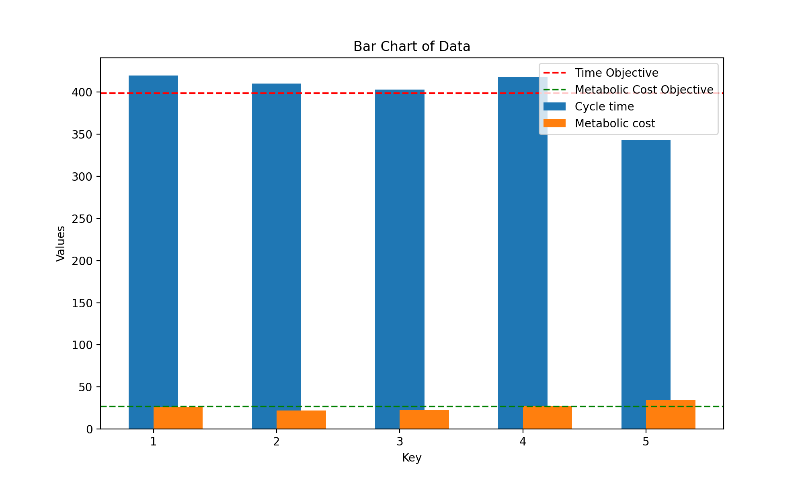

## Overview

This repository contains the implementation of a graph-based greedy heuristic for the Simple Assembly Line Balancing Problem (SALBP-1 type), extended with dual ergonomic constraints: **rest allowance (RA)** and **metabolic cost**. The method assigns tasks to a fixed number of operators while respecting precedence constraints, minimising workload imbalance, and ensuring physiological feasibility.

The approach is validated on a real-world hot water boiler assembly line comprising **160 tasks** and **193 precedence constraints**, with metabolic expenditure estimated via MTM-UAS.

This code accompanies the journal paper:

> *An Ergonomic Graph-Based Heuristic for Assembly Line Balancing with Rest Allowance* (under review)

## Features

- **Rest Allowance (RA) integration**: per-task rest allowances are pre-computed using the Price (1990) formula and used to inflate task times before balancing, ensuring physiologically feasible schedules.
- **Three distribution modes**:
  - `TIME` — greedy assignment driven by RA-adjusted cycle time; minimises cycle time imbalance.
  - `METABOLIC_COST` — greedy assignment driven by raw metabolic cost; equalises energy expenditure across operators.
  - `BOTH` — consensus mode that reconciles the TIME and METABOLIC\_COST solutions through a normalised, $\alpha$-weighted conflict-resolution step.
- **Smoothness Index** ($SI_C$, $SI_M$) and **line efficiency** ($\eta$) as performance metrics.
- **Sensitivity analysis** over number of operators ($K$), overload tolerance ($\delta$), and consensus weight ($\alpha$).

## Repository Structure

```
├── main.py                  # CLI entry point
├── algorithm.py             # Core graph-based greedy algorithm
├── experiments.py           # Sensitivity analysis experiments
├── files/
│   ├── data.txt             # Task cycle times and metabolic costs
│   └── precedencediagram.dot  # Precedence constraints (DOT format)
├── results/                 # Generated figures (PDF)
├── figs/                    # Example output plots
└── sn-article-template/     # LaTeX source of the companion paper
```

## Requirements

- Python 3.12+
- Standard libraries: `argparse`, `collections`, `math`
- `matplotlib` for plotting
- `graphviz` (optional, for visualising the precedence diagram)

Install dependencies:

```bash
pip install matplotlib
```

## Usage

```bash
python main.py <data_file> <precedence_file> <K> <MODE> [--threshold DELTA] [--alpha ALPHA]
```

| Argument | Description |
|----------|-------------|
| `data_file` | Path to task data file (cycle times and metabolic costs) |
| `precedence_file` | Path to DOT precedence diagram |
| `K` | Number of operators (workstations) |
| `MODE` | Distribution mode: `TIME`, `METABOLIC_COST`, or `BOTH` |
| `--threshold` | Overload tolerance $\delta$ in % (default: `10`) |
| `--alpha` | Weight for cycle time in BOTH mode conflict resolution, $\alpha \in [0,1]$ (default: `0.5`) |

### Examples

**TIME mode, 5 operators, no tolerance:**
```bash
python main.py files/data.txt files/precedencediagram.dot 5 TIME --threshold 0
```

**METABOLIC_COST mode, 7 operators:**
```bash
python main.py files/data.txt files/precedencediagram.dot 7 METABOLIC_COST --threshold 5
```

**BOTH (consensus) mode, 5 operators, equal weight:**
```bash
python main.py files/data.txt files/precedencediagram.dot 5 BOTH --threshold 0 --alpha 0.5
```



## Input Format

**`data.txt`** — one task per line, space-separated:
```
<task_id>  <cycle_time_s>  <metabolic_cost_kcal>
```

**`precedencediagram.dot`** — standard DOT directed graph:
```dot
digraph {
    1 -> 2
    1 -> 3
    2 -> 4
    ...
}
```

## Reproducing Paper Results

All sensitivity experiments (operators 3–10, thresholds 0–20%, $\alpha \in [0,1]$) can be reproduced by running:

```bash
python experiments.py
```

Output figures are saved to `results/`.

## Reference

If you use this code, please cite:

```
Paper details suppressed for blind review.
```

## License

This project is licensed under the MIT License.
